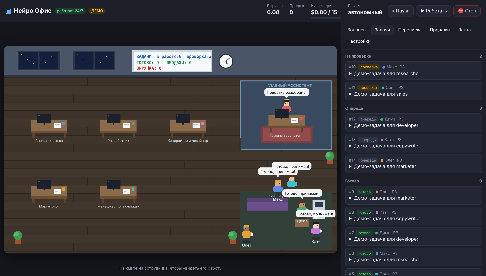

# Нейро Офис — команда ИИ-сотрудников, которая работает 24/7

Выглядит как игра: офис, столы, кухня, кабинет начальника. Но сотрудники — настоящие ИИ-агенты на Claude:
они исследуют рынок, создают продукты, пишут тексты, ведут переписку с людьми и продают.
Главный ассистент (директор) проверяет каждую работу и каждое письмо, возвращает на доработку и
сам планирует, кому что делать дальше. Вас спрашивают только о том, что вы сами отнесли к «решает владелец».



## Режим смен (запущен у владельца — без ключей и серверов)

Сейчас офис работает **сменами на подписке Claude**: каждые 2 часа запланированная задача Claude открывает
`shift/SHIFT.md` и проводит смену — директор планирует и проверяет, сотрудники работают, письма уходят через
подключённый Gmail, документы — в Google Drive, посты — черновиками в Typefully/Metricool.
Всё видно на приватной странице-офисе (игра + задачи + переписка + вопросы к владельцу), её база — в самой странице.

* Инструкция смены и правила: `shift/SHIFT.md`
* Страница: `shift/page_shell.html` + рисование офиса из `web/office.js` → `python shift/build_page.py` → `shift/office.html`

Ниже описан второй вариант — самостоятельный сервер на Claude API (нужен ключ и хостинг).

## Команда

| Сотрудник | Роль | Что делает |
|---|---|---|
| Алиса | Главный ассистент | Планирует, ставит задачи, проверяет все результаты и исходящие сообщения, выставляет продукты на продажу |
| Макс | Аналитик | Исследует рынок, находит ниши и потенциальных клиентов |
| Дима | Разработчик | Делает продукты: лендинги, боты, скрипты |
| Катя | Копирайтер | Тексты, гайды, описания продуктов |
| Олег | Маркетолог | Контент-план, посты в Telegram-канал |
| Соня | Продажи | Переписка с клиентами, предложения, ссылки на оплату |

Состав, роли, имена и обязанности меняются в `config/company.yaml`.

## Как устроена работа (без постоянных вопросов к вам)

```
 входящее письмо / заявка ──► задача для Сони
                                   │
 директор планирует ─► задачи ─► сотрудник работает ─► сдаёт на проверку ─► директор проверяет
                                   ▲                                          │
                                   └──────────── доработка с замечаниями ◄────┘
 письмо клиенту ─► проверка директором ─► правила безопасности ─► отправка
 продукт ─► проверка директором ─► ссылка на оплату Stripe ─► продажа ─► задача «передать покупку»
```

* Офис «просыпается» каждые `tick_seconds` секунд: раздаёт задачи, запускает проверки, отправляет одобренные письма,
  забирает новую почту. Если у кого-то нет задач — директор ставит новые. Работа не останавливается.
* Разрешения вы даёте **один раз** — в `config/company.yaml` (раздел `limits` и `escalate_to_owner`).
  Всё, что в рамках, агенты делают сами. За рамки — вопрос во вкладке «Вопросы».

### Встроенные предохранители

Это не «на всякий случай» — без них автономные агенты быстро сжигают бюджет, попадают в спам-фильтры
и портят репутацию компании.

* **Бюджет на ИИ в сутки** — при исчерпании офис отдыхает до завтра.
* **Антиспам**: лимит писем в день, лимит первых писем незнакомым, не больше N писем одному человеку в неделю.
* **Отписка**: если человек пишет «стоп / не пишите / unsubscribe» — ему больше никогда не пишут.
* **Честность**: в каждое письмо автоматически добавляется, что его подготовил ИИ-ассистент, и как отписаться
  (во многих странах это требование закона).
* **Секреты**: письма с ключами, паролями, номерами карт не уходят.
* **Деньги**: агенты не тратят ваши деньги, не делают возвратов и не подписывают договоры; цены выше лимита — только с вашего ответа.
* **Песочница**: агенты пишут файлы только в папку `workspace/`.
* **Кнопки «Пауза» и «⛔ Стоп»** в интерфейсе. «Стоп» мгновенно отменяет все неотправленные сообщения.

## Запуск за 5 минут

```bash
git clone <этот репозиторий> && cd Asistent
```

```bash
cp .env.example .env
```

Впишите в `.env` минимум `ANTHROPIC_API_KEY` и `OFFICE_ADMIN_TOKEN` (пароль для входа в офис). Затем:

```bash
pip install -r requirements.txt
```

```bash
python -m office
```

Откройте http://localhost:8000. Без ключа Anthropic офис запустится в **демо-режиме** (агенты «играют», ничего не тратят) —
удобно посмотреть, как всё выглядит.

### Круглосуточно на сервере

На любом VPS с Docker:

```bash
docker compose up -d --build
```

`restart: always` поднимет офис после сбоя или перезагрузки. Данные лежат в `data/`, результаты работы — в `workspace/`.
Обязательно задайте `OFFICE_ADMIN_TOKEN` и откройте сайт через HTTPS (например, Caddy или Nginx перед портом 8000).

## Подключение реального мира

| Что | Переменные в `.env` | Без подключения |
|---|---|---|
| Мозг агентов (Claude) | `ANTHROPIC_API_KEY` | демо-режим |
| Почта: отправка и входящие | `SMTP_*`, `IMAP_*` (для Gmail — «пароль приложения») | письма сохраняются как dry-run |
| Telegram: бот и канал | `TELEGRAM_BOT_TOKEN`, `TELEGRAM_CHANNEL_ID` (бот — админ канала) | посты сохраняются как dry-run |
| Оплата | `STRIPE_API_KEY`, `STRIPE_WEBHOOK_SECRET` | продукт «в продаже» без ссылки |

**Stripe:** в панели Stripe добавьте webhook на `https://ваш-домен/webhooks/stripe` с событием
`checkout.session.completed`. Тогда каждая оплата появится в «Продажах», клиент станет «customer»,
а Соня получит задачу передать покупку.

**Telegram:** люди могут переписываться с ботом, только если сами написали ему первыми — это ограничение Telegram.
Ссылку на бота агенты могут указывать в постах и письмах.

## Настройка под ваш бизнес

Главное — `company.mission` в `config/company.yaml`: опишите, что продаёте и кому. Дальше:

* `models.worker` — для экономии поставьте `claude-sonnet-5-5` или `claude-haiku-5-5` (директору лучше оставить Opus).
* `autonomy.mode: supervised` — если хотите сначала сами одобрять каждое письмо (кнопки во вкладке «Переписка»).
  Когда убедитесь, что директор проверяет хорошо, верните `autonomous`.
* `limits.*` — бюджет, лимиты писем, максимальная цена без вашего согласия.
* Во вкладке «Вопросы» можно дать офису указание («сделайте упор на кофейни в Казани») — директор перепланирует работу.

## Что важно понимать

* **Агенты работают честно, но не волшебно.** Первые недели смотрите вкладки «Задачи» и «Переписка»:
  по ним видно, что агенты делают хорошо, а где нужно уточнить миссию или правила.
* **Холодные письма регулируются законом** (GDPR в ЕС, CAN-SPAM в США, 152-ФЗ и закон о рекламе в РФ).
  Лимиты и подпись помогают, но ответственность за рассылки — на владельце компании. Начните с небольших лимитов.
* **Расходы.** При ценах Claude Opus 5.5 ($4/$20 за 1M токенов) активный офис из 6 сотрудников может тратить
  несколько долларов в час (зависит от объёма работы и модели). Дневной потолок задаётся `daily_llm_budget_usd`.

## Устройство проекта

```
config/company.yaml   компания, сотрудники, правила автономности
office/office.py      бесконечный рабочий цикл: задачи, директор, почта, продажи
office/agent.py       сотрудник: промпт + цикл «думает → использует инструменты»
office/tools.py       инструменты (файлы, задачи, CRM, письма, продукты) и права по ролям
office/policy.py      предохранители: бюджет, антиспам, отписки, секреты, цены
office/llm.py         Claude API (+ демо-мозг без ключа)
office/connectors/    почта, Telegram, Stripe
office/server.py      веб-сервер, управление, webhook оплат
web/                  офис-игра в браузере
tests/                тесты (pytest)
```

Тесты: `python -m pytest -q`
